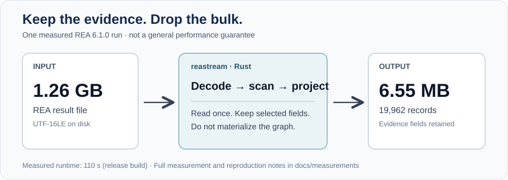

# reastream

I asked a reverse-engineering tool a question. It answered with a **1.26 GB file**.

I only needed the evidence header and a capability index, but the useful records were buried inside an enormous graph. Reading the entire JSON into memory felt like buying a house because I liked one doorknob.

So I wrote a streaming reader in Rust. It decodes, scans, and keeps the fields I asked for without loading the whole graph.

## What happened on the measured run

| | Result |
| --- | ---: |
| Input file | **1,264,678,208 bytes** (UTF-16LE on disk) |
| Decoded JSON | ~632 MB |
| Records extracted | **19,962** |
| Output kept | **6,547,610 bytes** |
| Runtime | **110 seconds**, release build |

Those figures came from one REA 6.1.0 run, not a universal benchmark. The [measurement notes](docs/measurements/README.md) include the environment and how the numbers were obtained.

## What's unusual about the file

The `graph` occupies almost the entire normalized result. REA's filter can discard it, but that also discards the evidence trail I wanted to keep.

The reader handles UTF-16LE output from Windows redirection, scans incrementally, and emits selected fields. [Decoder](src/decoding.rs), [lexer](src/lexer.rs), [projector](src/projector.rs), [dossier](src/dossier.rs), and [tests](tests/) are all in the repository.

I also made a deliberate decision **not** to reimplement REA's evidence hash. The tool copies its `evidence_id`; it does not independently authenticate it. Two programs disagreeing about what "valid evidence" means would be a particularly unfun bug.

If you want the CLI or library API, the commands and example belong in **[the usage guide](docs/usage.md)**, not on the front page. The [measured failure cases](docs/measurements/README.md) are worth reading too.

MIT licensed. This is a reader for analysis results, not an analysis engine.
